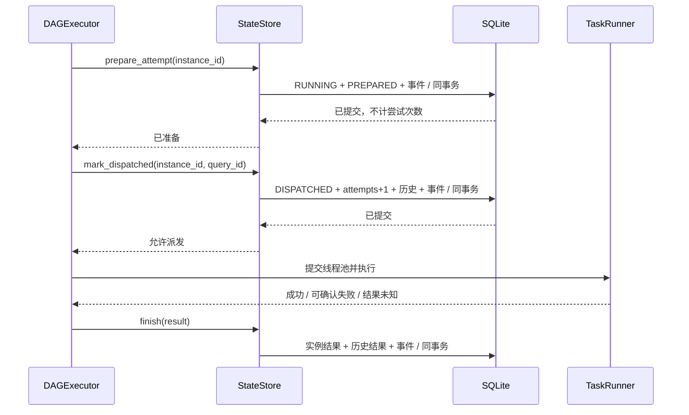
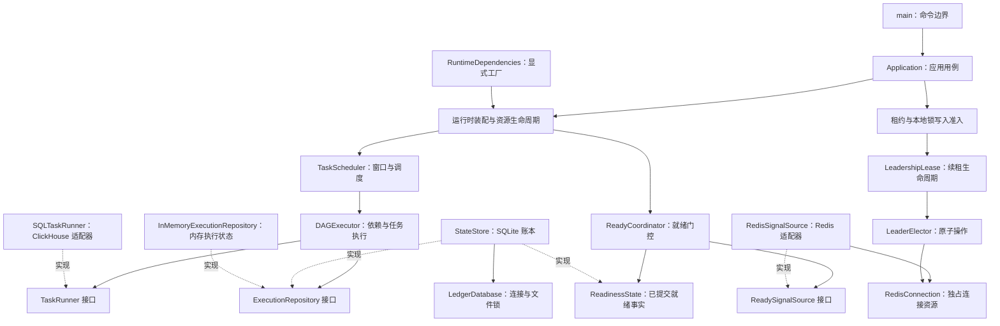

# 业务架构与扩展约定

当前目标是让现有汇聚流程易于替换依赖、定位故障和验证行为。当前包含 60 个任务，沿用现有 SQL、命令入口、状态身份和公司字节码构建方式。扩展接口不自动改变线上部署，也不新增消息系统或数据库。

## 恢复设计的核心语言

| 概念 | 职责与不变量 | 代码边界 |
| --- | --- | --- |
| 窗口实例 | 一个任务在一个确定窗口的计算；成功实例不可自动重放 | `dag/models.py`、`scheduler/service.py` |
| 准备 | 占用实例并分配 query_id；没有派发权限，不消费尝试预算 | `StateStore.prepare_attempt` |
| 派发 | 先提交意图、次数和历史，再允许调用运行器 | `StateStore.mark_dispatched`、`DAGExecutor._submit_instances` |
| 未知结果 | 外部可能已产生副作用，但没有完成证据；必须核对 | `TaskStatus.UNKNOWN`、`StateStore.resolve` |
| 事件 | 与业务状态在同一事务追加，不接受任意异常或上下文字段 | `state/events.py` |
| 恢复计划 | 在一致只读快照中解释下一次恢复会如何分类 | `diagnostics/recovery.py` |

这些概念直接对应接口、持久化事实和测试，不通过给目录改名模拟架构。应用层负责流程，领域接口表达能力，适配层拥有外部 I/O，账本层决定事务原子性。



准备后的崩溃可自动重新排队；派发意图提交后的崩溃仍按 UNKNOWN 处理，包括尚未实际进入线程池的保守窗口。SQLite 与 ClickHouse 没有共同事务，因此这里的 DISPATCHED 表示允许发送的持久化意图，不是服务端接收证明。

## 依赖方向



业务核心只依赖需要的能力。接口采用标准库 `typing.Protocol`；实现方无需继承框架基类，也无需向全局注册表注册。默认运行装配仍使用 ClickHouse、Redis 和 SQLite。

## 目录职责

```text
src/data_converge/
├── main.py                  # CLI 参数与退出码
├── application.py           # 应用用例与启动顺序
├── runtime.py               # 显式工厂装配、资源生命周期
├── config/                  # 配置解析、不可变策略、校验
├── dag/                     # 任务模型、依赖执行、仓储与运行器接口
├── scheduler/               # Cron 窗口规划、持久游标与补偿
├── dwd_ready/               # 五类就绪信号、窗口门控、消息确认
├── coordination/            # 写入资格的应用层编排
│   ├── ports.py             # WriterLease 窄接口
│   ├── admission.py         # 等待主权与本地锁准入
│   ├── guards.py            # SQL 提交/消息读取与确认前的资格校验
│   └── factory.py           # 组合租约与专用连接，明确释放顺序
├── leader_election/         # 原子 Redis 租约与续租线程
├── infrastructure/redis/    # Redis 连接资源与平台认证实现
│   ├── client.py            # 数据/Sentinel 连接池的唯一所有者
│   ├── auth.py              # 平台挑战认证协议
│   ├── credentials.py       # 凭据加载、账号选择、服务身份
│   └── crypto.py            # PSM 密钥与加密适配
├── sql_execution/           # ClickHouse HTTPS、XMS 与执行适配
├── state/
│   ├── store.py             # 业务状态转换和事务边界
│   ├── database.py          # SQLite 连接、文件锁、基础表与首次启动
│   ├── history.py           # 借用同一事务记录执行尝试和人工处置
│   ├── checkpoints.py       # 准备/派发事实与共用恢复分类
│   ├── events.py            # 同事务追加事件、只读有序分页
│   └── bootstrap.py         # 首次初始化标记，拒绝静默重建丢失账本
├── diagnostics/             # 只读状态、失败、历史和连接诊断
└── observability/           # 文件日志、轮转与保留策略
```

`infrastructure/redis` 不依赖 DWD 业务模块。消息消费、选主和在线检查使用同一连接工厂，但每次调用都拥有独立连接池，阻塞消费不会占用续租连接。选主不再通过消息消费者创建自身。认证、凭据和 PSM 的旧导入路径保留薄兼容导出，新代码使用共享实现。

`StateStore` 通过组合持有 `LedgerDatabase`，不通过继承共享连接状态。业务事务由 `StateStore` 开始和结束，审计只借用同一个连接，不单独提交。诊断保留只读连接入口；关闭时先关闭数据库，再释放文件锁，异常路径也释放资源。

公司约定的 `Services/Service/data-converge/{src,resources,test}`、`data_converge.main` 入口和配置路径保持不变。目录调整全部在 Python 业务包内，仍由原构建脚本编译、复制纯 `.pyc` 产物，测试不进入镜像。`execution_logging` 和 `logging_config` 保留旧接口兼容，生产持久账本是 `StateStore`。

## 设计模式对应的实际职责

| 设计 | 解决的问题 | 代码位置 |
| --- | --- | --- |
| Facade，用例门面 | CLI 不直接协调数据库、调度器和消费连接 | `application.py` |
| Repository，执行仓储 | 执行器统一读取、领取、完成和阻塞任务；消除内存与 SQLite 的重复分支 | `dag/ports.py`、`dag/memory.py`、`state/store.py` |
| Adapter，外部系统适配 | SQL 执行和消息消费的实现可替换，错误和确认语义由接口规定 | `sql_execution/runner.py`、`dwd_ready/redis_source.py` |
| Factory 与显式依赖注入 | 执行器、启动探测、消息源和心跳可在装配时提供，不依靠修改全局变量 | `runtime.py` 的 `RuntimeDependencies`、`ExecutionAdapter` |
| Strategy，策略分离 | 就绪判断、重试资格与日志保留规则独立于调度和文件操作 | `dwd_ready/coordinator.py`、`dag/retry.py`、`observability/retention.py` |
| Composition，组合资源所有权 | 账本事务与连接锁管理分离；队列和租约分别拥有独立 Redis 资源 | `state/database.py`、`infrastructure/redis/client.py` |
| Context Manager，资源生命周期 | 正常退出、部分启动失败和信号停止都按顺序释放资源 | `runtime.py`、`coordination/factory.py`、`observability/logging.py` |
| Decorator，提交资格保护 | 对任务提交与消息消费加入租约检查，业务适配器保持原职责 | `coordination/guards.py` 的 `GuardedRunner`、`GuardedSignalSource` |

`ExecutionAdapter` 同时提供任务执行器和启动探测函数，通用运行时无需读取某个具体执行器的连接配置。SQL 的默认装配绑定已解析的配置，继续执行原有 `SELECT 1` 探测。

## 扩展实现必须遵守的契约

### 增加一种任务执行方式

实现 `TaskRunner.__call__(instance)`，通过执行适配器工厂提供运行器和启动探测。失败时使用 `TaskExecutionError` 表达能否重试、结果是否未知以及查询标识。不能将无法确认结果的写操作伪装为可重试失败，也不能在异常正文中包含凭据或远端 SQL。

### 替换就绪消息源

实现 `receive`、`ack`、`close`，通过消息源工厂注入。`receive` 返回的消息在确认前必须能恢复。有效且属于已完成覆盖窗口的信号，在就绪事实提交成功后才 `ack`；无效、覆盖起点前或窗口尚未结束的信号，沿用记录诊断后丢弃并确认的原规则。连接或确认失败使用 `SignalSourceError`，协调器仍按固定诊断记录故障。五类信号、窗口判定和持久化顺序保持原规则。

### 增加执行状态后端

实现 `ExecutionRepository` 的领取、完成、状态读取与登记接口，先通过仓储契约测试。领取必须原子检查资格；成功状态不可自动重新领取；UNKNOWN 不自动重试；完成记录提交失败必须向上抛出。

需要支持准备阶段自动恢复时，同时实现可选 `CheckpointRepository.prepare_attempt` 和 `mark_dispatched`。执行器仅在完整能力可用时启用新协议，旧仓储继续调用 `claim()`；不能让运行器自行绕过派发事务。生产 StateStore 实现检查点，内存仓储保留旧行为，不声称具有持久化恢复能力。

这个接口覆盖 DAG 执行状态。完整替换 SQLite 还需要实现调度游标、部署身份、就绪事实、维护操作和写入所有权等职责。内存仓储用于进程内执行与验证，不提供重启恢复，不可当作生产持久化后端。

仓储由调度线程串行访问，工作线程只运行任务，不直接修改账本。现有内存仓储不承诺多线程共享安全；新增后端不能把这个调用约定当作多实例之间的互斥机制。

## 当前可靠性保证

| 故障或边界 | 当前行为 | 验收测试 |
| --- | --- | --- |
| 重复启动写进程 | 同一状态锁文件只允许一个写进程 | `test_lock_prevents_second_local_writer` |
| 服务重启 | 成功不重放；当前 PREPARED 重新排队；已派发或旧版 RUNNING 转 UNKNOWN | `test_dispatch_checkpoints.py`、`test_recovery_drill.py` 及原状态测试 |
| 派发事务失败 | 工作线程不会调用运行器；准备记录可以安全恢复 | `test_dispatch_commit_failure_prevents_runner_call` |
| 查询恢复和审计 | 只读一致快照，无建表、状态恢复或远端提交副作用 | `test_recovery_cli.py` |
| 任务登记中断 | 任务登记与调度游标一起提交或回滚 | `test_cursor_and_window_registration_rollback_together` |
| SQL 成功但记账失败 | 失败向上传播，停止派发，不转成可重试 SQL 失败 | `test_success_persistence_failure_escapes_instead_of_becoming_retry` |
| 就绪信号落盘失败 | 不确认消息、不放行窗口 | `test_commit_failure_does_not_ack_or_release` |
| 确认消息失败 | 已提交事实幂等重放 | `test_ack_failure_replays_durable_fact_after_restart` |
| 信号超时未齐 | 继续等待并告警 | `test_missing_or_zero_signals_timeout_warns_and_never_releases` |
| 启动失败或停止信号 | 关闭消息源、恢复信号处理、结束心跳，等待在途执行清理 | `test_partial_runtime_startup_releases_source_heartbeat_and_signal_handlers`、`test_launcher_waits_for_child_cleanup_after_stop` |
| 租约作用域内抛错 | 先停止续租并释放自己的租约，再关闭专用连接 | `test_lease_releases_before_disconnect_on_body_failure` |
| SQLite 关闭抛错 | 释放文件锁，清理可重复调用，允许后续进程接管 | `test_database_close_failure_releases_writer_lock` |
| Redis 构造部分失败 | 已创建的数据与 Sentinel 连接池由当前工厂回收 | `test_sentinel_client_creation_failure_releases_discovery_connections` |

这些是代码与故障测试所覆盖的保证，不构成可用率、吞吐量或恢复时间承诺。

每次正常成功执行新增一条准备检查点及 PREPARED、DISPATCHED、SUCCEEDED 三条事件；派发边界增加一次 SQLite 持久化提交。收益是可判定的恢复范围，成本是磁盘写入与账本容量，吞吐影响需在目标磁盘和真实任务负载下测量。事件和尝试历史暂不自动裁剪；文件日志轮转不会删除账本审计。完整设计及替代方案见 [恢复协议设计](superpowers/specs/2026-10-18-recovery-protocol-design.md)。

## 分布式高可用的边界

当前接入 Redis 租约协调；要延续原执行历史，仍需同一份完整持久账本及支持相应同步与锁语义的存储。SQLite 与 POSIX 文件锁只协调同一物理账本，不能让两个独立 hostPath 共享执行事实。按现场请求，账本身份和 Redis 永久注册校验已临时移除；新版不再读写这些身份项，旧值保留。独立账本可以在取得租约后通过该项准入，但其历史缺口及重复写风险尚未解决，见 [DC-STATE-001](known-issues.md#dc-state-001)。

`leader_election/` 通过随机会话 token、原子 Lua 续租/释放、保守截止时间与独立续租线程控制资格；失租后停止新派发，在途 SQL 收尾前持有账本锁。它不是 ClickHouse 端 fencing。心跳按实例隔离，Python 备机探针不读取主机心跳。公司探针脚本目前提前 `exit 0`，本轮保持部署与探针脚本不变。

ClickHouse 写入与 SQLite 记账没有共同事务，因此不宣称 exactly-once；UNKNOWN 需要核对后显式处理。此前 Deployment 的终止宽限期为 30 秒，而默认 SQL 超时为 300 秒，强制终止可能留下 UNKNOWN。

跨节点独立磁盘接管仍需要共享状态后端、存储隔离与下游 fencing，以及真实探针和终止预算。实现和运维边界详见 [可靠性说明](reliability.md)，不能用单机测试代替现场故障演练。
