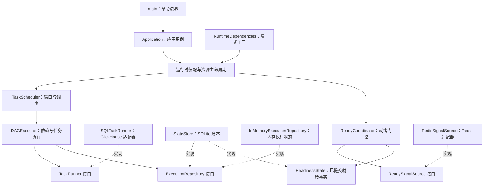

# 业务架构与扩展约定

当前目标是让现有汇聚流程易于替换依赖、定位故障和验证行为。保持 48 个任务、现有 SQL、命令入口、状态身份和公司字节码构建方式。扩展接口不自动改变线上部署，也不新增消息系统或数据库。

## 依赖方向

业务核心只依赖需要的能力。接口采用标准库 `typing.Protocol`；实现方无需继承框架基类，也无需向全局注册表注册。默认运行装配仍使用 ClickHouse、Redis 和 SQLite。

## 设计模式对应的实际职责

| 设计 | 解决的问题 | 代码位置 |
| --- | --- | --- |
| Facade，用例门面 | CLI 不直接协调数据库、调度器和消费连接 | `application.py` |
| Repository，执行仓储 | 执行器统一读取、领取、完成和阻塞任务；消除内存与 SQLite 的重复分支 | `dag/ports.py`、`dag/memory.py`、`state/store.py` |
| Adapter，外部系统适配 | SQL 执行和消息消费的实现可替换，错误和确认语义由接口规定 | `sql_execution/runner.py`、`dwd_ready/redis_source.py` |
| Factory 与显式依赖注入 | 执行器、启动探测、消息源和心跳可在装配时提供，不依靠修改全局变量 | `runtime.py` 的 `RuntimeDependencies`、`ExecutionAdapter` |
| Strategy，策略分离 | 就绪判断、重试资格与日志保留规则独立于调度和文件操作 | `dwd_ready/coordinator.py`、`dag/retry.py`、`observability/retention.py` |
| Context Manager，资源生命周期 | 正常退出、部分启动失败和信号停止都按顺序释放资源 | `runtime.py`、`observability/logging.py` |

`ExecutionAdapter` 同时提供任务执行器和启动探测函数，通用运行时无需读取某个具体执行器的连接配置。SQL 的默认装配绑定已解析的配置，继续执行原有 `SELECT 1` 探测。

## 扩展实现必须遵守的契约

### 增加一种任务执行方式

实现 `TaskRunner.__call__(instance)`，通过执行适配器工厂提供运行器和启动探测。失败时使用 `TaskExecutionError` 表达能否重试、结果是否未知以及查询标识。不能将无法确认结果的写操作伪装为可重试失败，也不能在异常正文中包含凭据或远端 SQL。

### 替换就绪消息源

实现 `receive`、`ack`、`close`，通过消息源工厂注入。`receive` 返回的消息在确认前必须能恢复。有效且属于已完成覆盖窗口的信号，在就绪事实提交成功后才 `ack`；无效、覆盖起点前或窗口尚未结束的信号，沿用记录诊断后丢弃并确认的原规则。连接或确认失败使用 `SignalSourceError`，协调器仍按固定诊断记录故障。五类信号、窗口判定和持久化顺序保持原规则。

### 增加执行状态后端

实现 `ExecutionRepository` 的领取、完成、状态读取与登记接口，先通过仓储契约测试。领取必须原子检查资格；成功状态不可自动重新领取；UNKNOWN 不自动重试；完成记录提交失败必须向上抛出。

这个接口覆盖 DAG 执行状态。完整替换 SQLite 还需要实现调度游标、部署身份、就绪事实、维护操作和写入所有权等职责。内存仓储用于进程内执行与验证，不提供重启恢复，不可当作生产持久化后端。

仓储由调度线程串行访问，工作线程只运行任务，不直接修改账本。现有内存仓储不承诺多线程共享安全；新增后端不能把这个调用约定当作多实例之间的互斥机制。

## 当前可靠性保证

| 故障或边界 | 当前行为 | 验收测试 |
| --- | --- | --- |
| 重复启动写进程 | 同一状态锁文件只允许一个写进程 | `test_lock_prevents_second_local_writer` |
| 服务重启 | 已成功任务不重复提交；遗留 RUNNING 转 UNKNOWN | `test_success_survives_reopen_and_is_not_submitted_again`、`test_abandoned_running_is_unknown_and_requires_explicit_resolution` |
| 任务登记中断 | 任务登记与调度游标一起提交或回滚 | `test_cursor_and_window_registration_rollback_together` |
| SQL 成功但记账失败 | 失败向上传播，停止派发，不转成可重试 SQL 失败 | `test_success_persistence_failure_escapes_instead_of_becoming_retry` |
| 就绪信号落盘失败 | 不确认消息、不放行窗口 | `test_commit_failure_does_not_ack_or_release` |
| 确认消息失败 | 已提交事实幂等重放 | `test_ack_failure_replays_durable_fact_after_restart` |
| 信号超时未齐 | 继续等待并告警 | `test_missing_or_zero_signals_timeout_warns_and_never_releases` |
| 启动失败或停止信号 | 关闭消息源、恢复信号处理、结束心跳，等待在途执行清理 | `test_partial_runtime_startup_releases_source_heartbeat_and_signal_handlers`、`test_launcher_waits_for_child_cleanup_after_stop` |

这些是代码与故障测试所覆盖的保证，不构成可用率、吞吐量或恢复时间承诺。

## 分布式高可用的边界

当前服务仍按单写实例运行。本地 SQLite 和文件锁不提供分布式租约或 fencing；使用独立状态文件的多个副本不能互相防重。此前提供的 Deployment 使用单副本与 hostPath，不能据此保证跨节点获得相同账本。

`leader_election/` 保留的旧实现没有接入运行主流程。其检查后续租、检查后释放不是原子操作，也没有隔离旧主写入的 fencing 机制，不能直接接入作为主备切换保证。公司探针脚本目前提前 `exit 0`，Python 心跳检查尚未通过这些脚本生效。本轮保持部署与探针行为不变。

ClickHouse 写入与 SQLite 记账没有共同事务，因此不宣称 exactly-once；UNKNOWN 需要核对后显式处理。此前 Deployment 的终止宽限期为 30 秒，而默认 SQL 超时为 300 秒，强制终止可能留下 UNKNOWN。

后续若进入主备或跨节点高可用建设，需要一起确定状态持久化与恢复位置、带 fencing 的唯一写入权、消息分配、真实探针和终止预算，再验证网络分区、主节点失联、强杀、依赖切换及恢复后的重复提交。接口重构为这项工作提供边界，不能代替故障演练。
