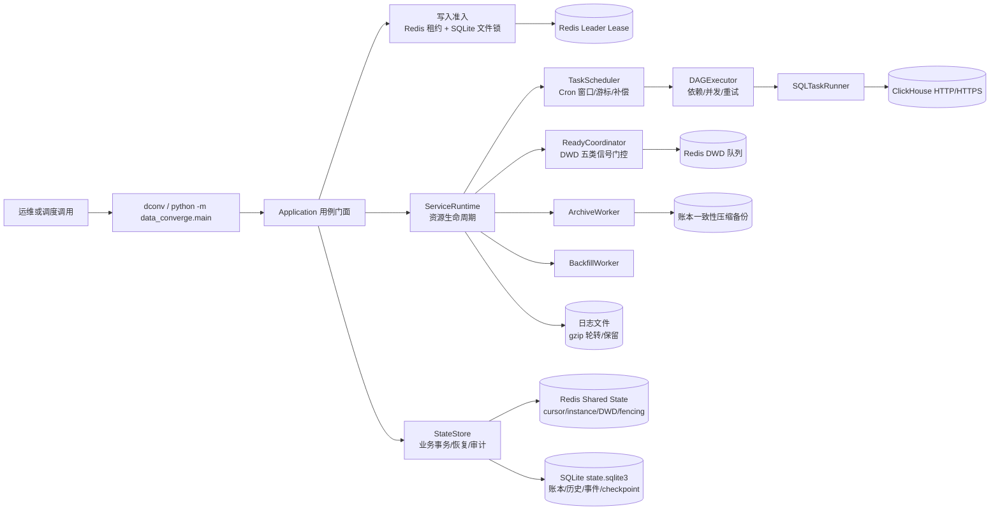
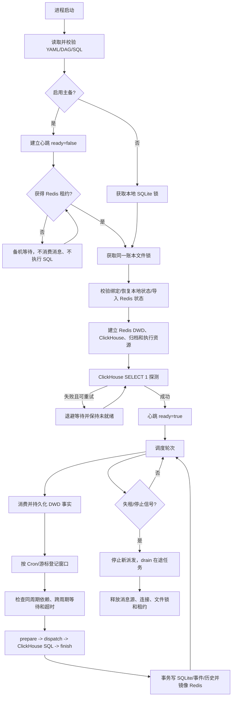
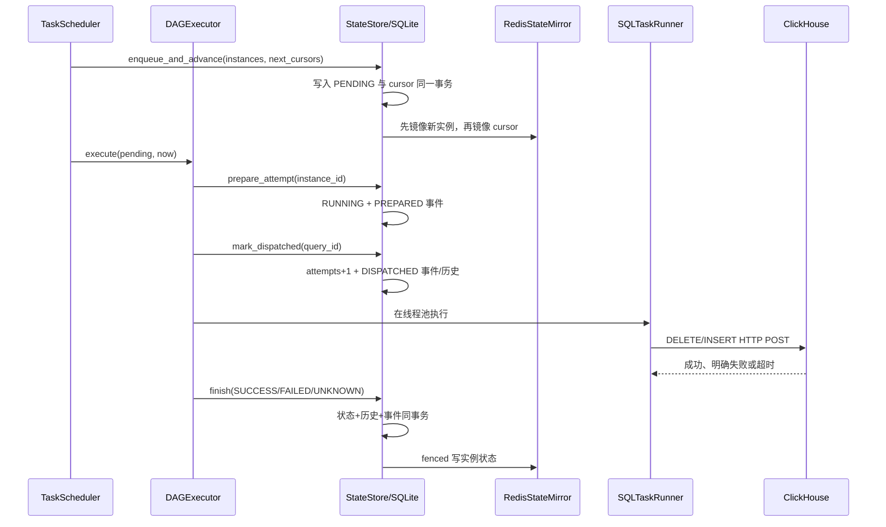
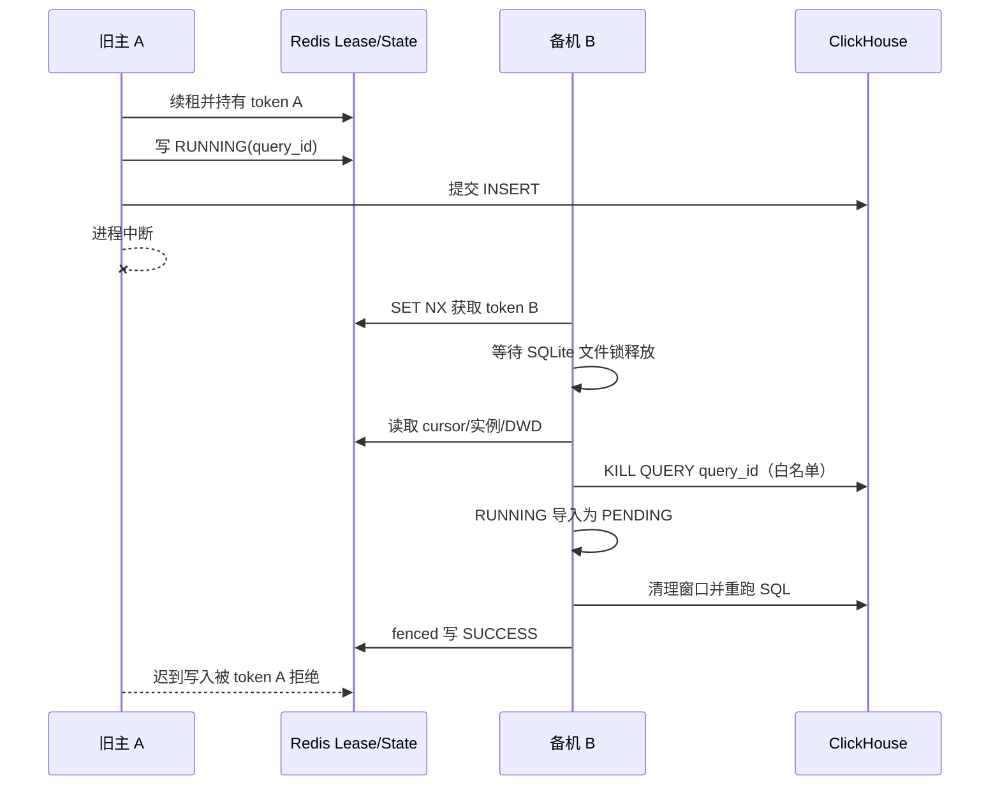

# Data Converge Lite 汇聚服务设计文档

| 项目 | 内容 |
| --- | --- |
| 文档目的 | 说明当前仓库的业务故事、架构、接口、实现、非功能设计和测试设计 |
| 适用对象 | 开发、测试、运维、评审和后续接手的实现人员 |
| 分析基线 | `main` 分支，提交 `5416104` |
| 生成日期 | 2026-11-05 |
| 运行时 | Python 3.12.10、ClickHouse HTTP、Redis、SQLite |

本文以仓库当前实现为准。代码中已经实现的行为、配置和已知边界与设计目标分开描述；没有 GUI、REST 服务或生产压测基准的部分明确标注为“不涉及”。

## 1 Story 概述

Data Converge Lite 是一个面向公司指标数据链路的汇聚服务。它从 DWD 数据层接收就绪信号，按照任务配置中的 Cron、聚合周期和依赖关系，把源表数据汇聚到 ClickHouse 的 DWS/ADS 目标表。当前规则文件包含 60 个任务，按 5 分钟、小时、天、月四种周期组织，每种周期 15 个任务，覆盖 GPU、节点、请求、模型实例、模型指标和资源等数据链路。

服务需要解决的核心问题是：ClickHouse 外部写入和本地状态记账不在同一个事务中。网络中断、进程退出或主备切换时，“服务没有收到成功响应”并不等于“ClickHouse 没有写入”。因此系统把一次执行拆成准备、派发、外部执行和结果记账四个可审计边界，并用 `SUCCESS`、`UNKNOWN` 等状态区分可以自动恢复和必须人工核对的情况。

本次设计的结果是一个配置驱动、可替换、可测试的汇聚运行时：

- 使用 DAG 维护同周期依赖，严格要求同周期上游成功；
- 使用 DWD 五类就绪事实放行 5 分钟任务；
- 使用 Redis 租约、独立连接池和 fencing token 实现主备写入准入；
- 使用 SQLite 账本、检查点、事件和执行历史保留可恢复事实；
- 使用共享 Redis 镜像同步游标、实例状态和 DWD 事实，首次 seed 同步本地 DWD 事实；主备接管先扫描 running 集合取消旧查询，再导入状态并重跑中断窗口；
- 使用 ClickHouse 连接池、任务级超时、有限重试和非阻塞线程池控制执行资源；
- 提供 CLI、诊断、恢复计划、历史、补算和配置迁移入口。

不在本仓库范围内的内容包括生产数据库建表和 RBAC、ClickHouse 集群本身、Redis 集群部署、公司镜像构建基础设施、Kubernetes 探针脚本改造和前端 GUI。

## 2 Story 上下文

### 2.1 系统架构图



运行时以 `Application._active_state()` 建立写入准入，再由 `open_runtime()` 装配执行器、调度器、DWD 消费、ClickHouse 探测、归档和信号处理。正常服务启动先把心跳置为未就绪，取得租约和账本锁、导入共享状态、完成 ClickHouse `SELECT 1` 探测后，才把应用心跳置为就绪并开始调度。

### 2.2 模块依赖关系

| 层次 | 主要模块 | 依赖方向和职责 |
| --- | --- | --- |
| 命令边界 | `main.py`、`cli_help.py`、`backfill/cli.py`、`diagnostics/cli.py` | 解析参数、路由用例、输出 JSON/文本和退出码；不直接操作外部服务 |
| 应用编排 | `application.py` | 统一配置快照、账本、租约、状态恢复和用例生命周期 |
| 运行时装配 | `runtime.py` | 通过 `RuntimeDependencies` 创建执行器、消息源、心跳、租约和连接资源 |
| 配置 | `config/` | YAML 读取、路径解析、策略校验、Cron 编译、配置版本和部署绑定 |
| 领域模型 | `dag/` | `TaskDefinition`、`TaskInstance`、DAG 拓扑排序、依赖和执行仓储协议 |
| 调度 | `scheduler/` | 持久游标、Cron 窗口、跨周期软等待、跳批次和后台补算 |
| 执行 | `dag/executor.py`、`sql_execution/` | 准备/派发/完成、线程池、ClickHouse HTTP、SQL 参数和错误分类 |
| 就绪门控 | `dwd_ready/` | Redis 队列 receive/ack、五类 DWD 事实落盘、5 分钟窗口放行 |
| 写入协调 | `coordination/`、`leader_election/` | Redis 租约、续租、失租停止、新写入准入和本地锁顺序 |
| 状态持久化 | `state/` | SQLite 事务、游标、任务状态、历史、检查点、事件、共享 Redis 镜像 |
| 观测与维护 | `observability/`、`archives/`、`diagnostics/` | 日志轮转、账本快照、在线诊断、失败和恢复计划 |

主要依赖关系为 `main -> Application -> Runtime -> Scheduler/DAGExecutor/ReadyCoordinator/SQLTaskRunner/StateStore`。DAG 执行器只依赖 `TaskRunner`、`ExecutionRepository` 等协议；默认实现分别是 ClickHouse 运行器和 SQLite `StateStore`。Redis 连接、认证和平台凭据由基础设施适配层拥有，业务层不直接创建裸连接。

### 2.3 外部服务接口

| 外部系统 | 接口形态 | 用途 | 关键约束 |
| --- | --- | --- | --- |
| ClickHouse | HTTP/HTTPS `POST` | `SELECT 1` 启动探测、清理 SQL、汇聚 `INSERT`、`KILL QUERY` | Basic Auth 请求头；URL 参数携带 `query_id`、时间窗口、`max_execution_time`、`max_threads`、`readonly`、`load_balancing` 等；返回受限 JSONCompact |
| Redis DWD | List + processing List | 接收 DWD 就绪消息 | `BRPOPLPUSH`/`RPOPLPUSH` 取消息，事实成功提交后 `LREM` 确认；确认失败允许幂等重放 |
| Redis Leader | Key + Lua | 选主、续租、释放 | `data_converge:leader:{cluster}` 使用随机 token；SET NX PX 和 compare-token Lua 保证旧主不能释放或续租新主租约 |
| Redis Shared State | Hash/Set + Lua | 同步游标、实例状态、DWD 事实、运行中集合 | `dc:{cluster}:inst:*`、`:cursor`、`:dwd:*`、`:running`；所有写入先用 token fencing；TTL 从数据窗口结束时间起算 |
| SQLite/本地文件系统 | SQLite + POSIX 文件锁 | 账本、历史、事件、检查点、备份和单写进程准入 | `state.sqlite3`、`.lock`、初始化标记和可选压缩快照必须位于持久卷；独立 hostPath 不提供安全接管 |
| KMS/PSM/XMS | 文件、环境和子进程标准输入 | 解密 ClickHouse/Redis 凭据 | 凭据不进入命令行和普通日志；具体服务发现和挑战认证由平台适配层完成 |
| Kubernetes/公司构建平台 | 启动脚本、Chart、字节码构建 | 部署和镜像组装 | 入口和构建目录保持兼容；本仓库不改生产 DDL、基础镜像和探针脚本 |

## 3 功能点分解

| 编号 | 功能点 | 主要实现 |
| --- | --- | --- |
| F1 | 配置驱动的 60 任务 DAG | `convergence_rules.yaml` + `DAGBuilder`；任务包含来源表、目标表、周期、Cron、依赖和 SQL ID |
| F2 | 多周期窗口调度 | `TaskScheduler` 通过 Cron 和持久游标规划 PT5M/PT1H/P1D/P1M 窗口，支持补偿上限 |
| F3 | 同周期依赖执行 | `DAGExecutor` 仅在同窗口上游为 `SUCCESS` 时派发下游 |
| F4 | 跨周期软等待 | 小时/天/月任务在 Cron 到点后按配置最多等待 300 秒，上游提前齐全即可执行，超时按已有数据并记录缺失 |
| F5 | DWD 就绪门控 | 五类 DWD 信号全部持久化后放行 5 分钟窗口；未齐只告警并保持阻塞 |
| F6 | ClickHouse 汇聚 | 清理目标窗口，再执行已有业务 SQL；参数使用 Unix 秒和系统时区，连接池并发上限 20 |
| F7 | 超时、重试和并发 | 周期超时为 120/600/1800/1800 秒；全局最大尝试 3 次；全局并发 4，同任务并行度 1-3 |
| F8 | 非阻塞调度 | 线程池提交后不等待一批全部结束，后续调度轮次继续派发；退出时 `drain()` 等待并记账 |
| F9 | 主备选举和失租停止 | Redis 租约、后台续租、保守本地截止时间；失租后不再接收新任务或消息 |
| F10 | 共享状态和 fencing | Redis 镜像游标、PENDING/RUNNING/SUCCESS 状态、DWD 事实；首次 seed 同步本地 DWD 事实；旧 token 写入被拒绝 |
| F11 | 接管恢复 | 新主在导入前扫描共享 running 集合并 KILL QUERY；导入共享状态后 SUCCESS 不重跑，RUNNING 重排为 PENDING；UNKNOWN 不自动重试 |
| F12 | 补算和跳批次 | `--backfill --recompute` 修正迟到数据；`--preaggregate` 测试未结束窗口；停机积压可 current_only 或 current_then_resume，超过 31 天不补 |
| F13 | 账本审计和诊断 | SQLite 事件、尝试历史、恢复计划、失败、DWD 状态、在线连接检查和 JSONL 事件导出 |
| F14 | 日志和账本维护 | 日志 10 MiB 轮转、gzip、最多 50 个、总压缩包 500 MiB；账本支持一致性压缩备份 |
| F15 | 配置迁移 | `--plan-config` 预览、`--apply-config` 显式应用，保存 manifest、版本、备份和任务生效起点 |

## 4 实现设计

### 4.1 接口描述

#### 4.1.1 对外提供的接口

系统没有 HTTP REST API，也不涉及 GUI；对外接口是命令行入口和平台启动脚本。

| 命令 | 输入 | 输出或效果 |
| --- | --- | --- |
| `dconv` / `python -m data_converge.main` | 无参数或 `--help` | 显示命令帮助 |
| `--validate-only` | `--config` | 校验配置、DAG、SQL 清单和任务数量 |
| `--init-state [--start-time ISO8601]` | 初次覆盖起点可选 | 创建账本、初始化绑定、覆盖起点和配置快照；不发 SQL |
| 默认启动 | `--config` | 取得租约和锁、恢复状态、探测 ClickHouse、进入持续调度 |
| `--run-once [--now ISO8601]` | 单轮调度时间可选 | 执行当前可派发实例并返回实例状态 |
| `--run-task TASK --scheduled-time TIME` | 任务名和带时区时间 | 手动执行一个窗口，仍受租约、依赖和状态保护 |
| `--status` | `--config` | 查询覆盖起点、状态计数、实例、DWD 窗口和历史摘要 |
| `--healthcheck liveness/readiness` | 状态目录 | 查询应用心跳；容器探针脚本本身保持平台兼容行为 |
| `--resolve-instance ID --resolution ... --note ...` | 显式处置原因 | 把 UNKNOWN/失败实例标记为成功或允许重试 |
| `--resolve-preaggregate ...` | 补算尝试 ID | 处置测试性提前汇聚结果 |
| `--backfill` / `--backfill-status` | 任务、时间范围、`--recompute` 或 `--preaggregate` | 计划、执行或查看补算；不自动重算已成功窗口 |
| `--diagnose`、`--failures`、`--history`、`--recovery-plan` | 可选过滤和 `--format json` | 只读输出诊断、失败、历史和恢复分类 |
| `--events --after-event N --limit M` | 分页参数、`--format jsonl` | 有序导出事务事件 |
| `--dwd-status`、`--inspect-instance` | 窗口或实例过滤 | 查看就绪事实、执行状态和诊断证据 |
| `--plan-config` / `--apply-config PLAN_ID` | 配置迁移计划 | 预览或显式应用配置版本和生效起点 |
| `bash /opt/its/data-converge/bin/start.sh` | 平台启动参数 | 兼容公司服务启动入口；本仓库不改变启动脚本协议 |

退出码由 `CommandResult.exit_code` 统一表达；普通错误只输出安全错误类型或固定错误码，不暴露凭据、远端响应正文和原始 SQL。

#### 4.1.2 内部新增接口

| 接口 | 方法 | 实现或用途 |
| --- | --- | --- |
| `TaskRunner` | `__call__(TaskInstance)` | 抽象一次外部任务执行；默认实现 `SQLTaskRunner` |
| `ExecutionRepository` | 状态登记、领取、完成、阻塞和读取 | `InMemoryExecutionRepository` 用于进程内测试，`StateStore` 用于生产 |
| `CheckpointRepository` | `prepare_attempt`、`mark_dispatched` | 记录准备和允许外部派发的持久边界 |
| `ReadySignalSource` | `receive`、`ack`、`close` | 默认实现 `RedisSignalSource`，可替换为其他消息源 |
| `ReadinessState` | 记录和查询 DWD 事实 | `StateStore` 负责事务和共享镜像 |
| `WriterLease` | `acquire`、`assert_owned`、`lost`、`close`、`token` | `LeadershipLease` 封装 Redis 租约和续租线程 |
| `RuntimeDependencies` | execution/source/heartbeat/leadership/Redis 工厂 | 运行时显式依赖注入，测试可替换外部服务 |
| `ExecutionAdapter` | `runner`、`probe`、可选带超时探测 | 让启动探测和执行器使用同一配置快照 |
| `RedisStateMirror` | 实例、游标、DWD 和 fencing 写读 | 主备共享状态适配器；Lua 校验 token |

### 4.2 功能实现思路

#### 4.2.1 整体设计目标

1. **状态可解释**：每个窗口都有明确任务 ID、时间范围、状态、query ID、尝试次数和事件序列。
2. **外部副作用保守恢复**：无法确认 ClickHouse 结果时标记 `UNKNOWN`，不把未知写入当作普通可重试错误。
3. **主备写入互斥**：Redis 租约负责跨实例准入，SQLite 文件锁负责同一账本，fencing 负责旧主迟到写入拒绝。
4. **原有业务兼容**：保留公司启动入口、SQL 文件、资源目录、字节码构建方式和旧 CLI 导出。
5. **依赖可替换**：通过标准库 `Protocol` 和 `RuntimeDependencies` 隔离 ClickHouse、Redis、心跳、租约和仓储。
6. **运行可观测**：提供结构化日志、历史、事件、恢复计划、失败诊断和 DWD 状态查看。

#### 4.2.2 关键设计决策

| 决策 | 选择 | 原因和边界 |
| --- | --- | --- |
| 状态来源 | Redis 共享状态用于主备接管，SQLite 用于本地事务和审计 | Redis 让备机看到游标和实例状态；SQLite 保留详细历史。Redis 与 ClickHouse 仍无共同事务 |
| 写入 fencing | Lua 脚本比较租约 token 后再写 | 旧主即使 SQL 晚到，也不能覆盖新主的状态 |
| 恢复分类 | PREPARED 可自动重排；DISPATCHED/RUNNING/旧版 RUNNING 为 UNKNOWN 或按共享状态重排 | 派发后外部副作用可能已发生，避免盲重试 |
| 成功去重 | `SUCCESS` 窗口不自动重跑 | 防止正常重启和主备切换造成重复汇聚 |
| DWD 确认顺序 | 事实落 SQLite 成功后才 ack Redis 消息 | 落盘失败时消息保留，重启后可幂等重放 |
| 依赖语义 | 同周期硬依赖；跨周期软等待 | 不让小时任务等待全部历史小时链路，但仍给迟到数据明确补算入口 |
| 调度并发 | 全局 4、单任务 1-3、ClickHouse 池 20 | 既限制服务资源，又避免单个长任务阻塞后续轮次 |
| 时间语义 | 业务窗口按进程系统时区，SQL 传 Unix 秒和显式时区 | 保证 DST 和容器时区变化下窗口边界可解释 |
| exactly-once | 不承诺 | ClickHouse 写入和 SQLite 记账没有共同事务；未知结果必须人工核查 |
| 配置迁移 | manifest、SQL hash、备份、生效起点和事务审计 | 防止任务定义、SQL 和执行历史无依据变化 |

### 4.3 功能实现设计

#### 4.3.1 流程图



#### 4.3.2 时序图

正常执行时，调度线程持有账本写入权；线程池工作线程只调用任务运行器，不直接修改账本。



主备接管时，Redis 租约、文件锁、共享状态和 ClickHouse 取消顺序如下：



#### 4.3.3 核心数据结构

**任务定义和实例**

| 结构 | 关键字段 | 语义 |
| --- | --- | --- |
| `TaskDefinition` | `taskname`、`source_tables`、`target_table`、`aggregation_interval`、`cron`、`depends_on`、`sql_id` | 配置中的静态任务定义 |
| `TaskInstance` | `instance_id`、`taskname`、`scheduled_time`、`data_start`、`data_end`、`status`、`query_id`、`attempts` | 一个任务在一个确定时间窗口上的执行事实 |
| `TaskStatus` | `PENDING`、`RUNNING`、`SUCCESS`、`FAILED`、`BLOCKED`、`UNKNOWN` | 状态转换和恢复分类 |
| `ExecutionReport` | `instances` | 一轮执行的成功、失败、阻塞和未知结果集合 |

**SQLite 账本**

| 表/文件 | 作用 |
| --- | --- |
| `metadata` | binding、coverage_start、配置迁移和运行元数据 |
| `configuration_history` | manifest、版本、备份路径、任务生效起点 |
| `schedule_cursors` | 每个任务下一次 Cron 窗口 |
| `task_instances` | 任务实例状态和错误、时间、query ID |
| `dwd_ready_signals` | 已提交的窗口和 DWD 类型事实 |
| `execution_attempts` | 每个 query ID 的尝试、状态、恢复时间和诊断 |
| `dispatch_checkpoints` | `PREPARED`、`DISPATCHED`、`NOT_SUBMITTED` 边界 |
| `execution_events` | 白名单事件的有序审计记录 |
| `preaggregate_attempts`、`backfill_*` | 提前测试汇聚和后台补算队列 |
| `state.sqlite3.lock` | 同一物理账本的 POSIX 写入锁 |

**Redis 共享状态布局**

```text
dc:{cluster}:inst:<instance_id>    HASH status/attempts/query_id/taskname/
                                        scheduled_time/data_start/data_end/error/updated_at
dc:{cluster}:cursor                 HASH taskname -> next_fire_time
dc:{cluster}:dwd:<window_start>     SET of DWD types
dc:{cluster}:running                 SET of instance keys currently RUNNING
data_converge:leader:{cluster}      String lease token with TTL
modelverse:dwd:ready                 List of external DWD messages
modelverse:dwd:ready:processing     List of messages being processed
```

Lua 写入脚本先比较 leader key 和当前 lease token，再执行 `HSET`、`SADD` 或 cursor 更新。实例和 DWD key 的过期时间从窗口结束时间起算；最小保留时间用于保证迟到写入仍有接管可见性。

### 4.4 数据库及文件持久化设计

本节适用，系统使用 SQLite 和本地文件持久化。

1. **事务边界**：`StateStore` 使用 `LedgerDatabase` 打开 SQLite 连接，业务状态、执行历史、事件和检查点借用同一事务。登记窗口和推进游标一起提交，任何一项失败都回滚。
2. **写入顺序**：对新排队实例，先在本地事务提交，然后将新实例镜像到 Redis，最后推进共享 cursor；这样共享 cursor 不会领先于备机可见的 PENDING 实例。
3. **恢复顺序**：服务先取得租约，再取得账本锁，然后恢复本地检查点并导入 Redis 共享状态。成功事实优先保留；旧主 RUNNING 按接管规则重排或进入 UNKNOWN。
4. **备份**：`ArchiveWorker` 按 `state.archives` 配置生成账本一致性压缩备份，默认保留 30 天；备份不删除活动账本记录。
5. **日志文件**：日志按 10 MiB 原始文件大小 gzip 轮转，最多 50 个、压缩包总量 500 MiB。日志是观测数据，不是执行事实来源。
6. **状态卷要求**：状态目录、锁文件、初始化标记和 SQLite 必须位于连续的持久卷。空目录自动初始化只适用于首次部署，不能恢复丢失历史。

### 4.5 GUI 界面

不涉及。当前产品通过 CLI、结构化日志、SQLite 诊断和 JSON/JSONL 输出提供运维界面，没有浏览器 GUI、桌面 GUI 或前端静态资源。

### 4.6 代码设计

#### 4.6.1 分层和资源所有权

- `Application` 是用例门面，负责校验输入和启动顺序，不直接实现 ClickHouse 或 Redis 协议。
- `RuntimeDependencies` 是默认工厂集合，确保测试可以替换执行器、消息源、心跳、租约和 Redis 连接。
- `StateStore` 组合 `LedgerDatabase`，由调度线程串行写账本；工作线程只运行外部任务。
- `DAGExecutor` 依赖仓储和运行器协议，负责领取、并发、重试、结果分类和 drain。
- `coordination` 用 `GuardedRunner`、`GuardedSignalSource` 在外部提交/消费前检查租约，适配器保持单一职责。
- 所有长生命周期资源使用上下文管理器或 `ExitStack` 管理，失败启动和信号停止都执行逆序释放。

#### 4.6.2 关键类设计

| 类 | 责任 | 关键协作 |
| --- | --- | --- |
| `Application` | 配置快照、状态初始化、租约/账本准入、共享状态接入 | `StateStore`、`admit_writer`、`open_runtime` |
| `ServiceRuntime` | 启动探测、心跳、调度启动、停止和租约检查 | `TaskScheduler`、`ExecutionAdapter`、`LeadershipLease` |
| `TaskScheduler` | Cron 规划、游标推进、DWD/跨周期门控、跳批次 | `DAGExecutor`、`StateStore`、`ReadyCoordinator` |
| `DAGExecutor` | 同周期依赖、任务并发、prepare/dispatch/finish、错误分类 | `TaskRunner`、`ExecutionRepository`、线程池 |
| `SQLTaskRunner` | SQL 文件加载、参数渲染、清理、超时和 ClickHouse 调用 | `ClickHousePool`、`ClickHouseClient` |
| `ClickHousePool` | 信号量限制汇聚连接并发 | `transport.py`、`client.py` |
| `ReadyCoordinator` | 消费 DWD、落盘、确认、判断五类信号是否齐全 | `ReadySignalSource`、`ReadinessState` |
| `LeadershipLease` | 获取、续租、失租截止和释放 | `LeaderElector`、Redis Lua |
| `StateStore` | SQLite 状态转换、审计、恢复和共享镜像 | `LedgerDatabase`、`RedisStateMirror` |
| `RedisStateMirror` | 主备共享状态和 fencing 写入 | Redis Lua、lease token |
| `ArchiveWorker` | 活动账本一致性快照和保留策略 | `archives/files.py`、`ArchiveSettings` |
| `BackfillWorker` | 后台补算队列消费，不阻塞正常调度 | `backfill/queue.py`、`SQLTaskRunner` |

## 5 关键非功能设计

### 5.1.1 TTM 可定制和易集成

- **配置化**：周期超时、并发、跨周期等待、跳批次、Redis 池、ClickHouse 池、日志保留和归档均可通过 YAML 调整。
- **兼容入口**：保留 `dconv`、`python -m data_converge.main`、`start.sh`、资源目录和公司字节码构建流程。
- **显式适配**：`RuntimeDependencies` 和 `Protocol` 允许替换 ClickHouse、Redis 消息源、心跳、租约和执行仓储。
- **接入边界清晰**：生产 DDL、RBAC、Redis/ClickHouse 集群创建和部署探针不在代码内，交付时由部署方完成。
- **迁移可控**：配置 manifest、SQL hash、备份和生效起点让新任务或 SQL 变化可以先预览后应用。

### 5.1.2 高性能

- ClickHouse 汇聚连接池最大 20 个连接，连接超时 10 秒；服务全局同时执行默认 4 个任务。
- 同一任务的批次并行度可配置为 1-3，防止单任务过度争抢资源。
- `DAGExecutor` 使用线程池和 `wait=False`，长任务运行时调度器仍可推进后续轮次。
- Redis 将 leader、status、log 拆为 3/15/5 的独立连接池，DWD 阻塞消费不会占用续租连接。
- 接管补发本地账本时先扫描共享实例集合建立 ID 差集，避免逐条读取 Redis；首次 seed 另外同步本地 DWD 就绪事实。
- 日志轮转按原始文件大小和压缩包总量限制；状态事件和检查点增加了磁盘写入成本。
- 仓库只有边界、并发行为和本地演练，没有生产吞吐、P99 延迟或容量压测基准；正式性能结论需要真实 ClickHouse、Redis、磁盘和任务负载测量。

### 5.1.3 可扩展性

- 新增任务主要通过规则 YAML、SQL 文件、Cron 和依赖关系完成，DAG 拓扑校验会拒绝未知依赖和环。
- 新的执行后端实现 `TaskRunner`；新的消息源实现 `ReadySignalSource`；新的状态后端实现 `ExecutionRepository` 和必要的 `CheckpointRepository`。
- 任务定义 manifest、SQL hash 和配置版本进入状态绑定，避免无审计替换执行语义。
- `backfill`、`preaggregate`、`skip` 和跨周期等待是独立策略，扩展不会改变正式游标的基本语义。

### 5.1.4 可测试性

- 依赖工厂和协议使测试可以使用内存仓储、Fake Redis、HTTP mock ClickHouse 和临时 SQLite。
- 调度器可以注入显式 `now`，时间策略和 DST 边界有独立测试。
- 账本事件、执行历史、检查点和恢复计划提供可验证的持久证据。
- 本地双实例演练使用真实服务进程、fakeredis TCP 和 mock ClickHouse，验证接管、重跑、fencing、参数和超时。
- 函数长度由 `test_code_rules.py` 检查，业务函数上限为 50 行。

### 5.2 可靠性、安全和运维边界

- SQLite 与 ClickHouse 没有共同事务，不宣称 exactly-once；`UNKNOWN` 必须核对后再处置。
- Redis 租约不是 ClickHouse 端 fencing；必须配合 token 镜像、KILL QUERY、下游幂等清理和完整持久账本。
- 默认 Pod 终止宽限期可能短于小时/天/月任务超时，滚动更新可能留下 UNKNOWN；现场需要调整终止预算或接受接管重跑。
- 密码通过请求头、文件或受控子进程输入传递，日志使用安全错误字段，不记录凭据和远端错误正文。
- 独立 hostPath 的两个副本不能自动共享执行历史；跨节点安全接管需要连续账本、共享状态、锁语义和现场演练。

## 6 开发者测试设计

### 6.1 单元和接口测试（UT）

| 测试范围 | 典型文件 | 验证内容 |
| --- | --- | --- |
| 配置和 DAG | `test_config.py`、`test_configuration_*.py`、`test_scheduler*.py` | 默认值、范围、Cron、DAG 环、窗口边界、时区和配置迁移 |
| 执行器 | `test_executor_nonblocking.py`、`test_executor_checkpoints.py`、`test_executor_timezone.py` | 非阻塞调度、同任务并行度、准备/派发/完成和重试资格 |
| ClickHouse | `test_clickhouse_pool.py`、`test_sql_execution.py`、`test_sql_preflight.py` | 池上限、settings、超时、请求参数、错误分类、凭据不泄露 |
| Redis/租约 | `test_redis_state.py`、`test_mirror_recovery.py`、`test_takeover_killer.py`、`test_leader_lease.py`、`test_writer_coordination.py` | Lua fencing、TTL、状态接管、旧主查询取消、旧主拒写、续租和释放顺序 |
| DWD | `test_dwd_ready_*.py` | receive/ack、落盘失败不确认、五类信号、窗口和超时告警 |
| SQLite/审计 | `test_state.py`、`test_execution_history.py`、`test_dispatch_checkpoints.py`、`test_execution_events.py` | 事务回滚、历史、事件顺序、恢复分类和文件锁 |
| 补算和归档 | `test_batch_skip.py`、`test_backfill_*.py`、`test_preaggregate_*.py`、`test_log_retention.py` | 跳批次、31 天边界、提前汇聚、日志轮转和总量限制 |

### 6.2 业务场景测试

1. **正常 5 分钟汇聚**：五类 DWD 信号全部到齐，同周期上游成功，DAG 按顺序写入目标表。
2. **跨周期软等待**：小时/天/月任务在 Cron 到点时等待上游，提前齐全立即执行，超时按已有数据并记录缺失。
3. **主备接管**：主实例在 SQL 中断，备机获得租约、等待文件锁、KILL 旧 query、导入状态并重跑中断窗口；已成功窗口不重跑。
4. **停机积压**：超过跳批次阈值时执行当前批次或当前批次后后台恢复，超过 31 天历史只记录不自动补跑。
5. **迟到数据**：成功窗口不自动重算，使用 `--backfill --recompute` 显式修正。
6. **配置升级**：预览 manifest 差异，应用前备份，应用后保存版本、任务生效起点和审计。
7. **启动依赖未就绪**：ClickHouse `SELECT 1` 失败时退避，应用保持未就绪，不启动调度和归档。

### 6.3 异常场景测试

| 异常 | 期望行为 |
| --- | --- |
| Redis 临时抖动 | 续租在本地截止时间前快速重试；超过截止时间永久失租并停止新派发 |
| 旧主 SQL 晚到 | token fencing 拒绝旧主状态写入 |
| ClickHouse 超时/连接失败 | 按错误类型分类；可重试错误遵守最大尝试次数，结果未知不盲重试 |
| 成功后 SQLite 记账失败 | 错误向上传播并停止继续派发，不能伪装成普通 SQL 可重试失败 |
| DWD 落盘失败 | 不 ack 消息、不放行窗口，重启后可重放 |
| DWD ack 失败 | 已提交事实保留，消息可幂等重放 |
| PREPARED 阶段崩溃 | 自动恢复为 PENDING，不消耗外部尝试次数 |
| DISPATCHED/UNKNOWN 阶段崩溃 | 记录 UNKNOWN 或等待共享状态核查，禁止自动重跑 |
| SQLite 文件锁冲突 | 备机等待原主释放锁，不能抢占正在 drain 的账本 |
| 配置/SQL hash 变化 | 生成诊断并按迁移策略处理，不静默采用新配置 |
| 凭据或远端错误返回 | 输出固定安全错误，不泄露密码、原始 SQL 和服务端正文 |

### 6.4 性能测试

仓库目前有可执行的性能相关行为测试，但没有独立生产压测方案。现有验证包括：

- 线程池在长任务期间仍能提交后续轮次；
- `task_parallelism` 1-3 的同任务并发上限；
- ClickHousePool 信号量不超过 20；
- Redis 三连接池隔离；
- 启动探测、任务超时、日志轮转和状态 TTL 的边界行为；
- 本地双实例演练的接管完成时间和窗口重跑结果。

正式性能测试应在目标环境补充：60 任务全量负载、ClickHouse 并发和内存峰值、Redis 连接数和续租延迟、SQLite 写入延迟、窗口端到端 TTM、主备接管 RTO/RPO，以及日志/账本增长曲线。当前文档不虚构这些指标。

## 7 参考资料清单

### 仓库内资料

1. `README.md`：运行入口、任务目录、配置和构建验证。
2. `Services/Service/data-converge/resources/config/app_config.yaml`：默认运行配置。
3. `Services/Service/data-converge/resources/config/convergence_rules.yaml`：60 个任务和依赖关系。
4. `docs/architecture.md`：业务架构、依赖方向、扩展契约和可靠性边界。
5. `docs/reliability.md`：六项可靠性问题、选主、恢复和部署边界。
6. `docs/known-issues.md`：DC-STATE-001、DC-STATE-002 等已知问题。
7. `docs/backfill.md`、`docs/state-archives.md`、`docs/diagnostics.md`：补算、备份和诊断操作。
8. `docs/superpowers/specs/2026-10-18-recovery-protocol-design.md`：恢复协议和派发边界。
9. `docs/superpowers/specs/2026-10-19-configuration-migration-design.md`：配置迁移设计。
10. `docs/superpowers/specs/2026-10-20-background-backfill-design.md`：后台补算设计。
11. `docs/superpowers/specs/2026-10-21-preaggregate-and-cross-period-wait-design.md`：提前汇聚和跨周期等待设计。
12. `docs/evidence/failover-drill-2026-11-04.md`：本地双实例主备演练证据。
13. `docs/evidence/recovery-verification-2026-10-18.md`、`test-summary-2026-10-18.json`：恢复和测试基线证据。
14. `docs/metrics-diff-release.md`、`docs/competition.md`：业务指标、发布范围和问题背景。
15. `Services/Package/images/bin/pyproject.toml`：Python 和运行依赖版本。

### 外部资料

- [Redis distributed locks](https://redis.io/docs/latest/develop/clients/patterns/distributed-locks/)
- [Redis commands](https://redis.io/docs/latest/commands/)
- [ClickHouse HTTP interface](https://clickhouse.com/docs/interfaces/http)
- [ClickHouse settings](https://clickhouse.com/docs/operations/settings/settings)
- [Python sqlite3](https://docs.python.org/3/library/sqlite3.html)
- [APScheduler 3.x documentation](https://apscheduler.readthedocs.io/en/3.x/)

