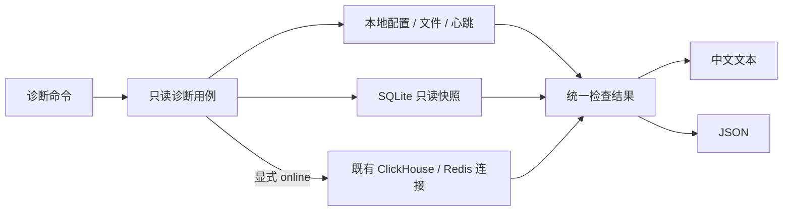

# 运行定位与诊断命令

诊断入口沿用现有启动辅助脚本，在 **data-converge 容器内**执行。脚本负责加载平台 `python.env`、业务代码、依赖目录及动态库路径，不需要上传脚本或单独拼接 `PYTHONPATH`。公司正式服务入口仍为 `bash /opt/its/data-converge/bin/start.sh`。

更新到包含诊断模块的镜像后使用以下命令。现有 `--status` 输出协议不变；新增命令默认中文文本，追加 `--format json` 输出同一份结构化结果。

## 常用命令

不熟悉参数时，直接查看内置中文帮助，包含按问题选择的入口、可复制的命令、时间格式和退出码说明：

```bash
bash /opt/its/data-converge/bin/start_data_converge.sh --help
```

`-h` 与 `--help` 等效。帮助在加载业务配置、日志和远端连接前退出；配置文件缺失时也能查看，但辅助脚本仍需可用的平台 Python 环境。

先看哪里异常，本地检查不连接 Redis 或 ClickHouse：

```bash
bash /opt/its/data-converge/bin/start_data_converge.sh --diagnose
```

需要验证解密、认证和远端连通性时显式启用在线检查：

```bash
bash /opt/its/data-converge/bin/start_data_converge.sh --diagnose --online
```

只列异常任务，优先显示 UNKNOWN，其次 FAILED、BLOCKED；查询全历史异常，不会被最近的成功任务挤出：

```bash
bash /opt/its/data-converge/bin/start_data_converge.sh --failures
```

筛选资源汇聚任务，或翻到下一页：

```bash
bash /opt/its/data-converge/bin/start_data_converge.sh --failures --task task_resource_5min_ads --limit 20
bash /opt/its/data-converge/bin/start_data_converge.sh --failures --limit 20 --offset 20
```

查看一个实例。下面使用现场曾出现的实例 ID；查询其他窗口时从 `--failures` 复制完整 ID：

```bash
bash /opt/its/data-converge/bin/start_data_converge.sh --inspect-instance 'task_resource_5min_ads@2026-10-14T16:30:00+08:00'
```

查看逐次执行历史。重试成功后，之前的失败证据仍可查询；无需在日志文件中搜索：

```bash
bash /opt/its/data-converge/bin/start_data_converge.sh --history --limit 20
bash /opt/its/data-converge/bin/start_data_converge.sh --history --task task_resource_5min_ads --limit 20 --offset 20
```

查看最近完整窗口的信号，或精确定位 16:15–16:20 窗口：

```bash
bash /opt/its/data-converge/bin/start_data_converge.sh --dwd-status
bash /opt/its/data-converge/bin/start_data_converge.sh --dwd-status --window '2026-10-14T16:15:00+08:00'
```

导出可回传的诊断结果：

```bash
bash /opt/its/data-converge/bin/start_data_converge.sh --diagnose --online --format json
```

`--limit` 范围为 1–100，默认 20；`--offset` 从 0 开始，供 `--failures`、`--history` 及 `--inspect-instance` 的历史分页使用。`--window` 必须为带时区、对齐五分钟的窗口**开始时间**，也接受 UTC 输入，展示时转换为北京时间。`--online` 仅用于 `--diagnose`；错误组合及空实例 ID 会拒绝执行，不会启动服务。

## 每个入口能回答什么

| 入口 | 证据和范围 |
|---|---|
| `--diagnose` | 配置可读性、DAG/SQL文件与调度规则、Python解释器与SDK可发现性、凭据/CA文件权限、日志老化配置及日志路径、本实例心跳、状态库及选主绑定、历史异常计数、最近20个完整DWD窗口 |
| `--diagnose --online` | 追加ClickHouse凭据解析与固定`SELECT 1`；Redis凭据/PSM客户端创建与`PING`、两个队列的`TYPE`/`LLEN`；启用选主时只读观察租约和永久账本注册项 |
| `--failures` | 全历史异常总数、分页结果、任务/窗口、尝试次数、query_id、固定错误码及处理建议 |
| `--history` | 按 query_id 保存的历次执行、真实结果、安全错误证据及人工处置；可筛选任务和分页 |
| `--inspect-instance` | 单个实例、当前及历次尝试的安全错误证据、SQL文件路径、当前未成功依赖、对应五分钟DWD状态；依赖最多显示100条并标明截断 |
| `--dwd-status` | 每个窗口的已收到/缺失类型、等待时长、最后接收时间、收齐延迟；包括一条信号也没收到的完整窗口 |

`--inspect-instance` 比较当前配置与状态库绑定，再按已记录的调度时间重建依赖。配置不一致时不猜测历史依赖；配置、依赖或附加错误证据损坏，也保留能够读取的实例基本信息。

任务的 `retryable` 只是原执行策略中的标记，仍需结合最大尝试次数及 `next_retry_at` 判断，不代表命令会发起重试。UNKNOWN 表示结果未确认，必须先凭 `query_id` 核实 ClickHouse 结果，再按原人工解决流程处理，不能直接重跑。

DWD `READY` 表示本消费者已记录五类信号；`WAITING` 表示缺信号；`BEFORE_COVERAGE` 和 `WINDOW_OPEN` 分别表示早于账本覆盖起点、窗口尚未结束。等待时长从窗口结束算起，收齐后停止累计，另用 `ready_delay_seconds` 保留收齐延迟。默认只看最近20个完整窗口，旧窗口用 `--window` 精确查询；更早的已登记阻断任务可用 `--failures` 查到。

## 输出与退出码

每项检查固定包含 `id`、`status`、`summary`、`evidence`、`action`。JSON顶层包含 `schema_version=1`、命令、检查时间、汇总状态和数据。

- `PASS`：该项检查通过，仅代表其声明的检查范围。
- `WARN`：存在需要关注的阻断/信号等待/配置提示。
- `FAIL`：已知错误、结果未确认的任务，或检查无法完成。
- `SKIP`：未启用、未显式请求，或前置条件不足，不能解释为正常。

退出码 `0` 表示没有 FAIL（可能包含 WARN/SKIP），`1` 表示存在 FAIL，`2` 表示参数错误。自动化可同时读取JSON中的各项状态。正常等待阈值内的窗口也可能是 WAITING，不能把整个命令 PASS 解读为全部窗口READY。

## 诊断边界与兼容

诊断业务代码不创建或修复状态库、不获取写锁、不创建心跳、不写业务日志、不改任务状态，也不消费或确认 Redis 消息。账本通过只读连接和单次读事务查看；Redis的两个队列读数为各自采样，不保证原子快照。辅助脚本仍沿用公司既有的环境准备流程，依赖尚未展开时可能先准备依赖文件。

在线检查复用原解密及认证实现，查询阶段沿用10秒ClickHouse超时和Redis配置的socket超时；解密使用原KMS超时。系统DNS阻塞仍受操作系统解析行为影响，不承诺整个命令固定10秒结束。Redis检查的 `credential_user` 表示选中的PMS账号，不等于服务端ACL用户名。

错误证据仅保存固定错误码、异常类型、query_id、HTTP状态、数字ClickHouse异常码、TLS校验码、OS错误号，不打印密码、SDK异常正文、服务端SQL或Redis消息内容。`execution_diagnostics` 保留与当前实例 query_id 匹配的当前失败证据；`execution_attempts` 在派发、finish 和恢复事务中保存逐次尝试，旧 claim 接口仍兼容，重试不覆盖旧记录。人工处置单独入账，不改变原尝试的真实结果，输出不包含备注正文。旧账本中没有尝试行的人工处理在 `legacy_resolutions` 单独展示，各自使用同一组分页参数；无法补造旧执行过程。诊断只读不建表，无历史表时显示“旧版本未记录”。

## 恢复预览与事务事件

```bash
bash /opt/its/data-converge/bin/start_data_converge.sh --recovery-plan --format json
bash /opt/its/data-converge/bin/start_data_converge.sh --recovery-plan --limit 20 --offset 20
bash /opt/its/data-converge/bin/start_data_converge.sh --events --after-event 0 --limit 100 --format json
bash /opt/its/data-converge/bin/start_data_converge.sh --events --after-event 0 --limit 100 --format jsonl > execution-page.jsonl
```

`AUTO_RESUME` 表示当前 RUNNING 实例具有匹配 query_id 的 PREPARED 证明。下次合法写进程启动时会重新排队；本次查询不会恢复任务。`RECONCILE` 表示已派发、旧版无证明或已有 UNKNOWN，先核对远端执行结果和窗口数据，确认原查询结束后才考虑人工处置。服务仍运行时，快照里的任务可能随后完成，不能将预览结果当作卡死判断。

事件每页最多 100 条，JSON 包装包含 `next_after_event` 和 `has_more`；继续读取时传入该游标。JSONL 每行是一条事件，不带分页包装；用最后一行的 `event_id` 续读，直到返回空页。JSONL 查询失败时 stdout 为空，错误报告写 stderr，退出码为 1，避免污染采集文件。旧账本尚无事件表时 JSON 显示 SKIP，JSONL 返回空页，不追补历史。

事件字段固定为 `event_id`、`schema_version`、`occurred_at`（UTC）、`event_type`、`instance_id`、`taskname`、`query_id`、`attempt_number`、`status`。事件序号只在同一账本内有效；跨部署采集应同时保存部署/账本来源。导出是可重复生成的投影，消费者按来源和事件序号去重。记录不含 SQL、异常原文或人工备注。

状态和事件同事务提交；事件落盘失败会使对应状态转换回滚。磁盘不可用时宁可停止派发，不把未保存的动作伪装成已完成。文件日志依旧由原日志组件轮转，事务事件和尝试历史暂不自动清理，应监控状态卷容量。

本地心跳通过只代表进程心跳与启动就绪，不能证明调度线程持续推进；诊断同时展示最近完成时间、最新窗口与最早活动窗口供判断。当前不新增调度线程探针、不改公司现有探针脚本。成功执行或`SELECT 1`通过不证明汇聚结果行数正确，也不验证所有现场表结构。原有资源汇聚SQL保持不变。

## 设计依据与实现分工

参考成熟项目的可操作设计：

- [Django CheckMessage 源码](https://github.com/django/django/blob/stable/5.2.x/django/core/checks/messages.py)：稳定检查标识、严重度、问题说明与修复提示。
- [Django check 命令源码](https://github.com/django/django/blob/stable/5.2.x/django/core/management/commands/check.py)：显式选择数据库检查及失败级别。
- [Kubernetes Pod 调试指南](https://kubernetes.io/docs/tasks/debug/debug-application/debug-running-pod/)：将配置、状态和故障原因放在一起查看。
- [Airflow 健康检查](https://airflow.apache.org/docs/apache-airflow/stable/administration-and-deployment/logging-monitoring/check-health.html)：分别判断元数据库、进程心跳及组件状态。

本实现按现有服务规模采用命令分派、独立检查函数、统一结果与文本/JSON呈现，复用现有连接适配器；没有引入Django、Airflow或新的依赖。



`diagnostics/cli.py`负责参数与分派；`service.py`组合检查；`checks.py`执行独立本地检查；`ledger.py`限制只读账本查询；`windows.py`解释就绪窗口；`connections.py`复用既有连接；`report.py`提供统一呈现。错误证据在`errors.py`白名单过滤，经执行器传入状态库，与任务完成一同提交。
