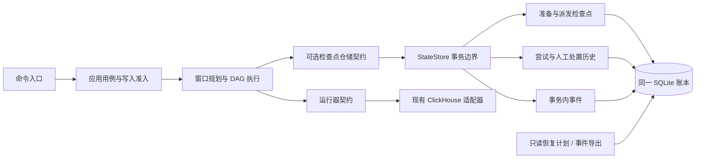
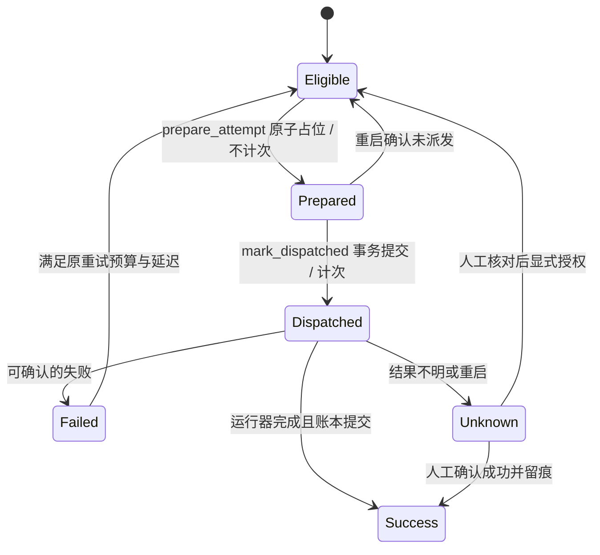

# 可证明的汇聚恢复：架构设计

## 目标与验收

用户希望重新实现中断恢复和执行记录，并用于工程创新、业务价值类比赛。交付包含可运行的实现、故障注入证据、架构说明和有证据边界的答辩材料。现有 56 个业务任务、SQL、部署及构建保持兼容，不新增第三方依赖。

业务目标是减少可以安全避免的人工处理、重复计算和排障成本。没有生产基线时，不填写节省金额、效率百分比、可用率或获奖概率。以实测的提交次数、恢复分类、历史记录和副作用作为本轮验收依据。

## 方案取舍

| 方案 | 收益 | 限制 | 结论 |
| --- | --- | --- | --- |
| 每次先删后写 | 表面上容易重跑 | 依赖真实表映射、集群拓扑、旧查询终止和插入去重语义；删除与写入无共同事务 | 不采用通用隐式清理 |
| 依据远端查询日志自动判断成功 | 可减少部分人工核对 | 日志有延迟、可能缺失；客户端成功未必等于最终落盘，依赖具体部署 | 保留为未来可插拔能力 |
| 在本地账本持久化准备与派发边界 | 能证明尚未派发的任务可恢复，不改业务 SQL | 派发意图提交后的崩溃仍可能 UNKNOWN | 本轮采用 |

## 统一语言

- **实例 Instance**：一个任务在一个确定数据窗口的工作单元，保持现有 instance_id。
- **准备 Reservation**：分配 query_id 并占用实例，但未允许调用运行器，不消耗执行次数。
- **派发 Dispatch**：先持久化允许调用运行器的意图，再提交线程池；此时消耗一次尝试预算。
- **尝试 Attempt**：以 query_id 关联一次派发及其结果；派发意图不等于服务端已经执行。
- **未知结果 Unknown**：外部副作用可能发生，账本没有可信完成记录；不能盲目重放。
- **事件 Event**：与状态转换同事务追加的有序事实，供诊断和 JSONL 导出。
- **恢复计划 Recovery plan**：对当前账本的只读分类，不代表已经执行恢复，也不代替写入资格检查。

## 组件与依赖

调度线程持有数据库连接并修改账本，工作线程只调用运行器。不在外部请求期间持有 SQLite 事务。保留 ExecutionRepository 和 claim() 原有语义，通过单独的可选 CheckpointRepository 能力扩展生产仓储；旧适配器仍走保守路径。

## 恢复协议

1. `prepare_attempt(instance_id, now, max_attempts)` 检查与现有 claim 相同的资格，保存 RUNNING 和 PREPARED；分配新的 query_id，不增加 attempts，不伪造 execution_attempts。
2. `mark_dispatched(instance_id, query_id, now)` 使用当前实例、query_id 和 PREPARED 做条件检查；同事务设置 DISPATCHED、增加 attempts、创建尝试历史及事件。提交成功后才允许 pool.submit。
3. 提交失败向上传播，运行器不会被调用。停止请求在每次派发前重新检查，未派发的准备记录留待安全恢复。
4. 恢复只处理当前 RUNNING 实例。当前 query_id 匹配 PREPARED 的实例重新排队，检查点记为 NOT_SUBMITTED，次数保持不变；DISPATCHED、旧版本无检查点或无法证明未派发的实例转 UNKNOWN。历史 UNKNOWN、SUCCESS 不动。
5. 派发意图提交到 pool.submit 之间崩溃，也必须 UNKNOWN。这一保守窗口不会被包装成 exactly-once。
6. 原显式人工处置仍独立留痕，不把 UNKNOWN 的原尝试历史改写成成功。

## 审计和可观测性

新增事务内事件表，字段固定为事件序号、协议版本、UTC 时间、事件类型、实例、任务、query_id、尝试号及状态。禁止写入 SQL、密码、配置对象、原始异常或人工备注。事件序号只在同一账本内有意义。

事件通过只读命令按序号分页，并支持 JSONL 输出到 stdout，操作人员可重定向到文件或交给采集器。SQLite 是权威记录，导出是可重复生成的投影；不引入另一个批次数据库，不声称文件导出与 SQLite 跨资源原子提交。日志原有轮转机制继续管理服务运行日志。

恢复计划输出类别、理由、当前 query_id、尝试次数及下一步动作，使用与真正恢复一致的判断逻辑。查询使用只读一致快照，不初始化、不迁移、不恢复、不申请租约、不访问 ClickHouse。

## 兼容与资源边界

- 不修改 TaskDefinition 序列化和部署绑定指纹；旧账本无需重建。
- 新表仅在有写锁的写入事务里创建；旧账本只读查询返回能力不可用，不补历史。
- 旧 claim() 保持“调用者可能已提交”的语义，恢复仍 UNKNOWN。
- 所有 Python 函数、方法、测试和 fixture 不超过 50 行；测试保留在原 test 目录。
- 不改变部署、启动脚本、公司构建框架或业务 SQL。
- 保留 Redis 租约与本地锁准入；不承诺独立磁盘之间自动接管或 ClickHouse fencing。

## 验证与比赛证据

验收必须覆盖准备后进程退出、派发意图后退出、外部已接受但成功未记账、历史事件写入失败、重复调度、停止请求、旧账本以及只读查询。故障演练使用真实 SQLite 和真实子进程退出，外部运行器以可计数的本地接收记录代替；结果明确标为离线协议验证，不当作 ClickHouse 集群验收。

可主张的工程贡献：明确的提交边界、可证明的安全自动恢复集合、事务内可追踪事件，以及可重复的故障演练。业务价值由这些能力映射到人工核对量、重复提交量、排障证据收集步骤；生产金额与耗时收益留待实际采样。
